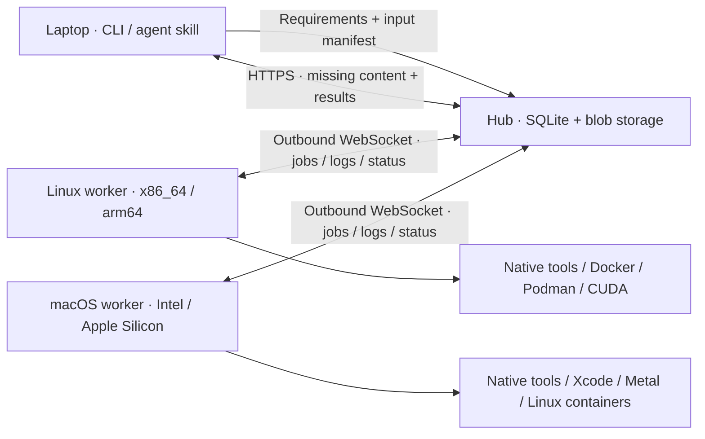
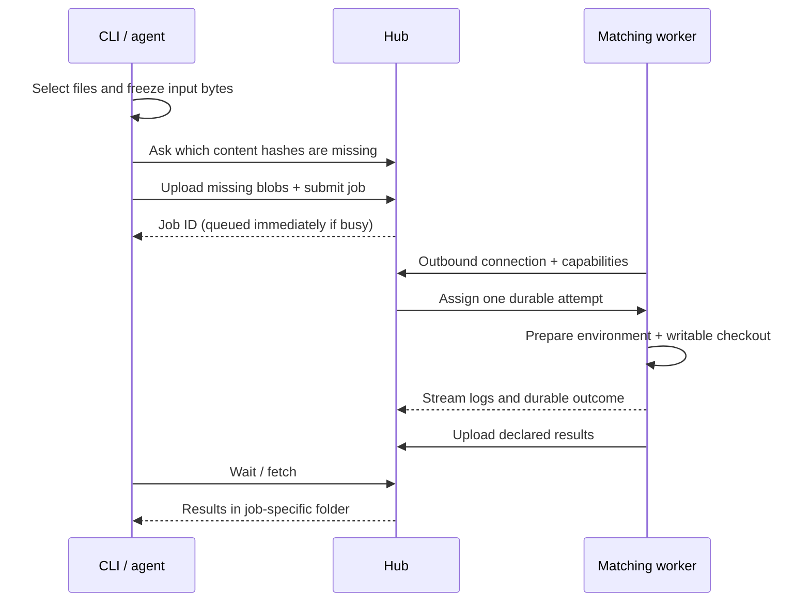

<div align="center">


# Your Local Cloud Computing

**Put your other computers to work.**

Run builds, tests, rendering and GPU workloads across your own Linux and macOS machines, from a CLI or coding agent.

[Quick start](#quick-start) · [Agents](#use-from-an-agent) · [Containers](#docker-and-podman) · [Environments](#reusable-environments) · [MIT](LICENSE)

</div>

YLCC is a small self-hosted compute pool: one hub, workers on your machines, and a requester CLI. Workers connect outward to the hub. You do not need inbound worker ports or SSH during jobs. Use a private HTTPS endpoint, such as a Tailscale Serve address, to connect machines.



## What you get

- OS, CPU architecture, tool version, ABI, CPU feature and GPU backend requirements; busy matching workers queue jobs.
- Selected inputs by default, optional whole-project snapshots, and SHA-256 content transfer that sends missing blobs only.
- Writable job checkouts, remote reusable environments, durable logs and declared outputs downloaded to a separate job directory.
- Native services, Docker/Podman packaging, and an agent skill that uses the same CLI. No remote LLM is required.

This is a pool for trusted people and trusted code. Native jobs have the worker service user's permissions. A container runtime socket grants control over that runtime and its mounted host resources. Other CI workloads remain the machine owner's resource-management responsibility.

## Install the CLI

Download a versioned binary for Linux/macOS on x86_64/arm64. The installer verifies the archive against the release's `SHA256SUMS` before installing it:

```bash
curl -fL https://raw.githubusercontent.com/Kobbokkom/your-local-cloud-computing/v0.1.0/scripts/install.sh -o /tmp/ylcc-install.sh
bash /tmp/ylcc-install.sh --version v0.1.0
export PATH="$HOME/.local/bin:$PATH"
ylcc --version
```

Use `--prefix /your/prefix` to change the install location. You can also download and check the [release archives](https://github.com/Kobbokkom/your-local-cloud-computing/releases) yourself. macOS builds are unsigned command-line programs; they are not notarized application bundles. Linux release binaries require glibc 2.35 or newer so native workers can load GPU driver libraries. On musl-based systems such as Alpine, use the container image or build from source for your system; GPU probing additionally requires dynamic library loading. Workload binaries keep their own platform/ABI requirements.

### Download examples and agent support files

The binary installer installs the executable only. Before using the example jobs, environment recipes, Compose/Quadlet files or agent installer below, fetch the matching versioned support checkout outside your application project:

```bash
export YLCC_SUPPORT_DIR="$HOME/.local/share/ylcc/support/v0.1.0"
mkdir -p "$(dirname "$YLCC_SUPPORT_DIR")"
git clone --depth 1 --branch v0.1.0 \
  https://github.com/Kobbokkom/your-local-cloud-computing.git "$YLCC_SUPPORT_DIR"
```

Keep this directory for the examples below. Reuse it if already cloned; it contains public support files, never your pool token. Commands reference this directory explicitly or run examples in a subshell, preserving your application's working directory.

To build the CLI from this checkout instead of downloading a binary:

```bash
cargo build --manifest-path "$YLCC_SUPPORT_DIR/Cargo.toml" --locked --release
mkdir -p "$HOME/.local/bin"
install -m 755 "$YLCC_SUPPORT_DIR/target/release/ylcc" "$HOME/.local/bin/ylcc"
```

## Quick start

### 1. Start a hub

On an always-on machine, create a token and a persistent hub directory. `init` generates a protected token file and never prints its contents or replaces an existing token.

```bash
ylcc init
ylcc hub --listen 127.0.0.1:7443 --data-dir "$HOME/.local/share/ylcc/hub"
```

In another terminal, publish only to your private network. For example, with Tailscale installed and HTTPS enabled for your tailnet:

```bash
tailscale serve --bg --https=10000 http://127.0.0.1:7443
```

Use the resulting private `https://HUB.example.ts.net:10000` address below. Keep any existing Serve configuration intact; do not enable Funnel. See [Tailscale Serve](https://tailscale.com/docs/reference/tailscale-cli/serve).

All authorized requesters and workers need the same token file. Transfer it through your existing secure administration channel, keep it outside projects and images, and restrict it with `chmod 600`. The default is `~/.config/ylcc/token`. The shared token authorizes arbitrary pool workloads; only distribute it to trusted operators.

### 2. Connect workers

On each worker, install the CLI and place the token file. Then:

```bash
export YLCC_HUB_URL=https://HUB.example.ts.net:10000
export YLCC_TOKEN_FILE="$HOME/.config/ylcc/token"
ylcc worker --id linux-build --data-dir "$HOME/.local/share/ylcc/worker" --max-jobs 1
```

Use a distinct ID on every worker. Worker data contains source snapshots, writable attempts, logs and reusable environments. Point `--data-dir` to a mounted persistent SSD if desired. The worker reports what it can actually execute; it does not advertise native macOS from inside a Linux container.

### 3. Configure your requester and run work

On your laptop, set the same URL and token file, then save these references for later sessions:

```bash
ylcc --hub https://HUB.example.ts.net:10000 --token-file "$HOME/.config/ylcc/token" configure
ylcc --json workers
ylcc --json doctor
```

From the [support checkout](#download-examples-and-agent-support-files), inspect the example's transfer manifest and execute it on a matching worker:

```bash
(
  cd "$YLCC_SUPPORT_DIR"
  ylcc manifest --input examples/jobs/hello.rs
  ylcc run --input examples/jobs/hello.rs --os linux --arch x86_64 \
    --tool rustc='*' --output result.json \
    -- sh -c 'rustc examples/jobs/hello.rs -o hello && ./hello'
)
```

The worker must already have `rustc` available, or use a [registered environment](#reusable-environments). `--tool NAME=VERSION` requires the reported exact version; `*` accepts any detected version. `--build-target` adds a toolchain target requirement; it does not alter your build command or install a missing SDK automatically.

For asynchronous work, add `--detach` and keep the returned job `id`:

```bash
ylcc jobs show JOB_ID
ylcc jobs logs JOB_ID
ylcc jobs wait JOB_ID
ylcc jobs fetch JOB_ID
ylcc jobs cancel JOB_ID
```

`run` without `--detach`, and `jobs wait`, automatically fetch declared outputs. Results go to `~/.local/share/ylcc/results/JOB_ID/`, configurable with `--results-dir`. `jobs fetch` reports the actual path. Use `--no-download` to leave outputs remote. Results never overwrite your project automatically.

### Input and execution rules



Select files/folders with repeated `--input`, use `--project` for the whole project, or explicitly use `--no-input` for a command requiring no local files. Directory discovery follows Git's ignore rules, while tracked files use their current working content, including uncommitted changes. Explicitly selecting an ignored **file** includes that file only. Inspect `manifest` before including generated files or credentials. Symlinks are rejected rather than followed outside the selection.

Inputs are immutable after submission; changing local files affects the next submission. Each attempt gets a fresh writable checkout. Only declared relative output paths are collected. No implicit heavy local fallback, automatic retry on another worker, or cross-architecture emulation occurs. A disconnected/`unknown` attempt needs inspection before resubmission because its original process may still exist.

## Background services

Install under the account that should run workloads. On shared managed machines, use a dedicated account without administrative rights; keep management credentials out of that account.

```bash
ylcc --hub https://HUB.example.ts.net:10000 --token-file "$HOME/.config/ylcc/token" \
  service install --role worker --id linux-build --data-dir "$HOME/.local/share/ylcc/worker"

# On the hub machine, using its own local listen address:
ylcc service install --role hub --listen 127.0.0.1:7443 --data-dir "$HOME/.local/share/ylcc/hub"
```

Linux uses `systemd --user`: inspect `systemctl --user status ylcc-worker` and `journalctl --user -u ylcc-worker`. An administrator must enable linger with `loginctl enable-linger SERVICE_USER` for startup without login. Installing from a shell requires a working user manager/session bus.

macOS uses a login LaunchAgent by default: `launchctl print gui/$(id -u)/org.ylcc.worker`. Logs are in the selected data directory. The user must log in and any external data volume must be mounted. For a dedicated headless account, an administrator can use `service install --system-user SERVICE_USER ...` to install a LaunchDaemon running as that user. Prepare an existing user-owned data directory and readable protected token first:

```bash
sudo /absolute/path/to/ylcc --hub https://HUB.example.ts.net:10000 \
  --token-file /absolute/service-home/.config/ylcc/token service install \
  --system-user SERVICE_USER --role worker --id mac-build \
  --data-dir /absolute/persistent-volume/ylcc/worker
```

Service installation captures the current executable location and native user's `PATH`; keep the binary there. System-user macOS installs set a user-specific `HOME` and a standard tool path. After changing tool paths, reinstall the service and verify capabilities under the service account. Updates should wait until active jobs finish before restarting a worker. Never replace running environments mid-job.

Remove the user service with `ylcc service uninstall --role worker` (or `hub`). This retains tokens and workload data; remove those explicitly only when no longer needed. System-user LaunchDaemon removal uses `service uninstall --role worker --system-user SERVICE_USER` as an administrator.

## Docker and Podman

The worker image supports Linux amd64 and arm64. It includes YLCC, CA certificates, Git, Bash and curl; workload tools belong in reusable environments or your own image. The plain image has no runtime socket or nested container daemon.

Using the [support checkout](#download-examples-and-agent-support-files), publish the Compose hub only on host loopback and bind persistent directories owned by your current user. The worker shares the hub's network namespace and connects over its loopback, keeping plaintext HTTP local. Preserve the token's owner-only mode:

```bash
export YLCC_UID="$(id -u)" YLCC_GID="$(id -g)"
export YLCC_DATA_DIR="$HOME/.local/share/ylcc/containers"
export YLCC_TOKEN_FILE="$HOME/.config/ylcc/token"
mkdir -p "$YLCC_DATA_DIR/hub" "$YLCC_DATA_DIR/worker"
docker compose -f "$YLCC_SUPPORT_DIR/compose.yaml" up -d
```

The worker connects to `http://127.0.0.1:7443` inside the shared network namespace. To join an existing private hub instead, run only a worker with a persistent data mount:

```bash
mkdir -p "$YLCC_DATA_DIR/worker"
docker run -d --init --name ylcc-worker --restart unless-stopped \
  --user "$YLCC_UID:$YLCC_GID" \
  --mount "type=bind,src=$YLCC_DATA_DIR/worker,dst=/data" \
  --mount "type=bind,src=$YLCC_TOKEN_FILE,dst=/run/secrets/token,readonly" \
  ghcr.io/kobbokkom/your-local-cloud-computing:0.1.0 \
  --hub https://HUB.example.ts.net:10000 --token-file /run/secrets/token \
  worker --id container-worker --data-dir /data --max-jobs 1
```

For rootless Podman service management, copy `$YLCC_SUPPORT_DIR/examples/quadlet/ylcc-worker.container` ([example](examples/quadlet/ylcc-worker.container)) to `~/.config/containers/systemd/`, replace the hub URL and worker ID, then `systemctl --user daemon-reload && systemctl --user start ylcc-worker`. Its keep-id mapping lets the service read your mode-600 token. See [Podman Quadlet](https://docs.podman.io/en/latest/markdown/podman-systemd.unit.5.html).

### Optional sibling-container execution

Native workers can use an already configured Docker or Podman runtime. To request a workload image, pass `--container IMAGE`, or use an image environment. A containerized worker needs an explicitly installed runtime client and access to the host runtime. Build the optional client target from a matching release binary:

```bash
mkdir -p "$YLCC_SUPPORT_DIR/dist"
cp /path/to/matching-linux-binary/ylcc "$YLCC_SUPPORT_DIR/dist/ylcc"
docker build --target runtime-client -t ylcc-runtime-client:0.1.0 \
  -f "$YLCC_SUPPORT_DIR/Dockerfile" "$YLCC_SUPPORT_DIR"
```

Mount the daemon socket explicitly and add the socket's group to the worker. **This grants the worker control of that host runtime.** Bind-mount the worker data directory at the **same absolute path** on host and worker, and pass that path as `--data-dir`; sibling container mounts are resolved by the host daemon, not the worker container. This profile uses a client only, never Docker-in-Docker. Docker Desktop path sharing and rootless Podman socket permissions must also allow the chosen paths/user.

For a Docker socket, set `YLCC_RUNTIME_SOCKET` to its absolute path and `YLCC_RUNTIME_GID` to its numeric group ID, then:

```bash
: "${YLCC_RUNTIME_SOCKET:?Set the Docker socket path}" "${YLCC_RUNTIME_GID:?Set its numeric group ID}"
export YLCC_RUNTIME_DATA="$HOME/.local/share/ylcc/runtime-worker"
mkdir -p "$YLCC_RUNTIME_DATA"
docker run -d --init --name ylcc-runtime-worker --restart unless-stopped \
  --user "$(id -u):$(id -g)" --group-add "$YLCC_RUNTIME_GID" \
  --mount "type=bind,src=$YLCC_RUNTIME_SOCKET,dst=/var/run/docker.sock" \
  --mount "type=bind,src=$YLCC_RUNTIME_DATA,dst=$YLCC_RUNTIME_DATA" \
  --mount "type=bind,src=$YLCC_TOKEN_FILE,dst=/run/secrets/token,readonly" \
  ylcc-runtime-client:0.1.0 \
  --hub https://HUB.example.ts.net:10000 --token-file /run/secrets/token \
  worker --id runtime-worker --data-dir "$YLCC_RUNTIME_DATA" --max-jobs 1
```

Build custom workload images outside YLCC, push them to GHCR/Forgejo or another registry, and register their immutable digest. Runtime credentials stay with the service user; they do not belong in the environment catalog.

## Reusable environments

Register and prepare Rust, Node or Python image environments from the [support checkout](#download-examples-and-agent-support-files):

```bash
ylcc env add "$YLCC_SUPPORT_DIR/examples/environments/rust.json"
ylcc env prepare rust-linux --worker linux-build
ylcc env status
(
  cd "$YLCC_SUPPORT_DIR"
  ylcc run --input examples/jobs/hello.rs --os linux --arch x86_64 \
    --environment rust-linux --output result.json \
    -- sh -c 'rustc examples/jobs/hello.rs -o hello && ./hello'
)
```

The example image references are pinned multi-platform digests. Use [Node](examples/environments/node.json) or [Python](examples/environments/python.json) similarly. Image environments execute on a worker with a usable container runtime; Docker on macOS still runs Linux. Images are pulled and verified in the actual execution environment, and resolved digests/readiness are stored per worker.

For native Linux/macOS tools, [the rustup recipe](examples/environments/rust-native.json) installs a pinned toolchain into the environment's user-owned directory. Project-specific recipes can use existing version managers such as mise, a release binary, or Git clone/build commands. Commands receive `YLCC_ENV_DIR`, with its `bin` directory prepended to `PATH`; environment values expand `${YLCC_ENV_DIR}` and `${PATH}`. Keep install steps repeatable and versioned, and provide `verify` commands that fail when the expected tools are unusable.

Use a new `revision` when changing an environment, then `env add` and `env prepare` explicitly. Preparation/update is serialized and drains active work on the worker. Jobs can prepare their requested native environment when first used. Image environments are immutable: put setup in the image Dockerfile, not a disposable setup command. Persistent environment/cache data lives under the worker data directory and must be mounted for a container worker. Updating a worker image is an explicit pull/recreate after jobs drain, with these mounts retained.

Installing an API CLI does not authenticate it. Supply required credentials through the service user's existing secure configuration. Drivers, system SDKs and Xcode remain host setup; the tool does not change them automatically.

## Use from an agent

Install the CLI, configure the requester, [download the support files](#download-examples-and-agent-support-files), and install the bundled skill globally or per project:

```bash
bash "$YLCC_SUPPORT_DIR/scripts/install-skill.sh" --global
# Or:
bash "$YLCC_SUPPORT_DIR/scripts/install-skill.sh" --project /path/to/project
```

Start a new agent session. For Codex, skills are discovered from `~/.agents/skills` or the project's `.agents/skills`; the included skill permits normal automatic selection. See [Codex skills](https://learn.chatgpt.com/docs/customization/overview#skills). Other agents supporting the open skill format can load [skills/ylcc/SKILL.md](skills/ylcc/SKILL.md) from their documented skill directory.

Ask naturally: “Build this on a Linux x86_64 worker and bring back the binary,” or explicitly invoke `$ylcc`. The skill discovers workers, chooses requirements and selected inputs, submits asynchronously, checks logs/status and downloads declared results. It does not add an MCP server or run another agent on the worker.

## GPU and platform checks

Programs must actually use the requested GPU backend. `--gpu cuda`, `--gpu rocm` and `--gpu metal` select distinct capabilities; they do not translate CPU code or pool GPU memory over the network. Check `workers` and run an actual workload to validate device/driver access under the service account. Container GPU execution additionally needs the host's NVIDIA/CDI or ROCm runtime configuration.

From the [support checkout](#download-examples-and-agent-support-files), the [CUDA driver example](examples/jobs/cuda.py) performs GPU vector addition using Python's standard library and an installed NVIDIA driver. The [Metal example](examples/jobs/metal.swift) dispatches a Metal compute kernel:

```bash
(
  cd "$YLCC_SUPPORT_DIR"
  ylcc run --input examples/jobs/cuda.py --os linux --arch x86_64 --gpu cuda \
    --output result.json -- python3 examples/jobs/cuda.py
  ylcc run --input examples/jobs/metal.swift --os macos --arch aarch64 --gpu metal \
    --output result.json -- swift examples/jobs/metal.swift
)
```

macOS/Xcode work requires a native Mac worker and the appropriate SDK. Requesting Linux x86_64 from an Apple Silicon laptop selects a matching worker; it does not make the result a macOS executable. Cross-compilation needs the relevant linker/sysroot/SDK and an explicit build command. Emulation is not implemented in v0.1.0.

## Diagnose and develop

`ylcc doctor` reports local capabilities and configured workers. Check service logs, actual service-account `PATH`, token permissions, private HTTPS reachability and container runtime access first. A worker connection loss is distinct from command failure. Persist the hub database/blob directory and worker data; do not delete an unknown attempt's files while its process may still be running.

```bash
(
  cd "$YLCC_SUPPORT_DIR"
  cargo test --locked
  bash scripts/test-install.sh
  cargo build --locked --release
)
```

CI builds/tests on native Linux x86_64, Linux arm64, Intel macOS and Apple Silicon macOS. Release automation creates four archives, checksums, a multi-platform image and a draft GitHub Release for final real-machine validation. Published release availability and successful local hardware tests are separate checks.

YLCC is independently implemented under the [MIT license](LICENSE). It does not incorporate RCH code. v0.1.0 does not include MCP, a registry, peer-to-peer data transfer, an automatic retry engine, or scheduling reservations for unrelated CI jobs.
